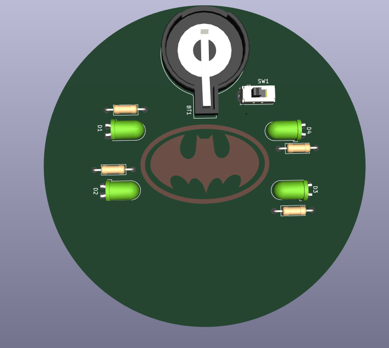

# bat-signal badge

## project goals
* **Target Specs:** circular matte black PCB badge with a translucent bat signal window powered by a 3-volt CR2032 coin cell and four yellow DIP LEDs with 100 ohm current limiting resistors.
* **Design Philosophy:** keep the front completely clean by hiding every component on the back and letting light diffuse directly through bare fiberglass where copper and solder mask are stripped away [because hiding your ugly soldering mistakes is peak engineering].
* **Why I'm building this:** hack club holiday hardware swap needed a beginner friendly soldering kit and i wanted to build something that actually looks cool on a backpack instead of another boring blinking square.

## deep brief
this project is a custom through-hole soldering kit designed for the hack club holiday hardware swap. it features a circular matte-black PCB badge with a translucent bat-signal window right in the center. by stripping away copper traces and solder masks on both the top and bottom layers over the bat silhouette and ring, light from the LEDs diffuses cleanly through the bare fiberglass without any distracting shadows or text markings. 

all components mount exclusively on the back side to keep the front face looking pristine. power comes from a 3-volt CR2032 coin cell housed in a socket holder and routed through an SPDT slide switch. the lighting circuit consists of four parallel branches pairing 100-ohm axial resistors with 5-millimeter yellow DIP LEDs. yellow LEDs were chosen specifically for their low two-volt forward voltage which works perfectly with a 3-volt coin cell. the LED legs are bent at 90-degree angles so their domes aim directly inward toward the bat emblem from the left and right wings keeping the entire assembly 100 percent through-hole and well under budget.

## bill of materials (BOM)

| Name | Quantity | Price |
| :--- | :---: | :---: |
| Coin Socket | 5 | 0.63 |
| Lithium Coin Battery | 5 | 1.17 |
| Slide Switch | 5 | 0.15 |
| 100 Ohm Resistor | 26 | 0.15 |
| 5mm LED Yellow | 13 | 0.15 |
| PCB | 5 | 11.30 |
| **Total Price** | — | **13.55** |

## visual showcase

*(a gorgeous 3d render of the bat signal badge before i burn my fingers with the soldering iron)*

*(the PCB layout showing the stripped fiberglass bat silhouette waiting to glow)*
